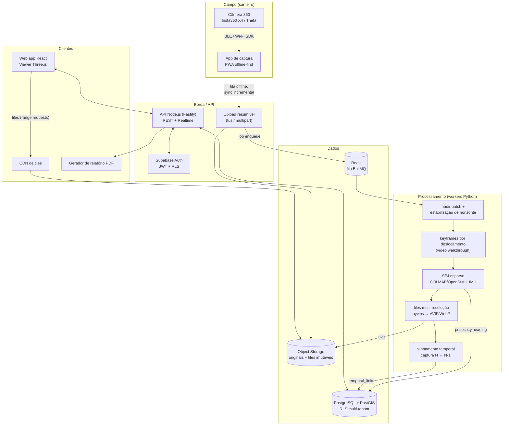

# Arquitetura — Obra360

## Diagrama geral

## Decisões e justificativas

| Camada | Escolha | Por quê |
|---|---|---|
| Viewer | Three.js puro (esfera + textura tiled) | Controle total da sincronização de câmeras no split-screen; Marzipano/Pannellum dificultam o lock de câmeras |
| Estado do viewer | Zustand | O viewer exige estado local de alta frequência (yaw/pitch a cada frame) fora do ciclo do React |
| Banco | Supabase (Postgres + PostGIS + Auth) | Planta, pontos de captura, pins e extents são geometria; o login é o Supabase Auth e o RLS isola cada organização |
| Fila | Redis + BullMQ | Jobs longos (SfM de 20 min de vídeo) com progresso visível ao usuário |
| Workers | Python (OpenCV, COLMAP, pyvips) | Ecossistema de visão computacional; isolado do app por contrato de fila |
| Tiles | Equiretangular piramidal → cubemap na fase 2, AVIF com fallback WebP, chave com hash de conteúdo | Imutáveis = cache infinito na CDN; primeiro frame < 2s em 4G exige preview de 2048px carregado antes dos tiles |
| Upload | tus (resumível) | Canteiro tem internet ruim — requisito, não detalhe |
| Imutabilidade | Capturas são append-only; deleção só por owner com trilha em `audit_log` | O valor jurídico do produto depende disso |

## Fluxo de uma captura (fase 1 — ponto fixo)

1. Técnico marca waypoints na planta (uma vez por pavimento).
2. Em cada waypoint, dispara a câmera 360; o app grava foto + metadados (obra, pavimento, waypoint, autor, timestamp, heading do IMU).
3. Fila offline sobe originais quando houver rede; job de processamento roda nadir patch + tiles.
4. Posição = a do waypoint marcado (sem SLAM na fase 1). Heading = IMU + ajuste manual opcional.
5. `temporal_links` são criados por igualdade de waypoint (mesmo ponto físico).

Na fase 2 (walkthrough por vídeo), os passos 1–2 viram "aperte gravar e caminhe":
keyframes extraídos por deslocamento estimado, SfM esparso posiciona sobre a planta com
âncoras manuais de calibração, e o fallback quando o SfM falha é a interpolação
IMU + correção manual na planta (a UI de correção já existe desde a fase 1).

## Requisitos não-funcionais (como serão atendidos)

- **Primeiro frame < 2s em 4G**: preview equiretangular 2048×1024 AVIF (~150 KB) carregado imediatamente; tiles de alta resolução em streaming progressivo por face/nível.
- **10.000 m² em < 60 min**: paralelismo por panorama (nadir/tiles são embaraçosamente paralelos); SfM é o gargalo — particionar por trecho contíguo de vídeo.
- **Custo de storage**: original 360 (~8 MB) vai para storage frio após 90 dias; tiles AVIF quentes (~2,5 MB/panorama). Estimativa: obra de 10.000 m², captura semanal, 60 panoramas/captura ≈ 2,6 GB/mês quente.
- **LGPD**: detecção de rostos (YOLO/RetinaFace) + blur no worker, flag por tenant.
